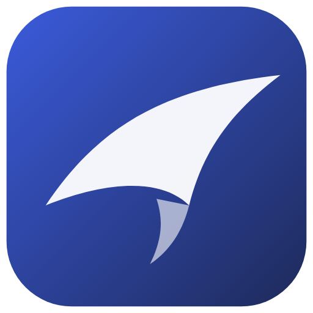
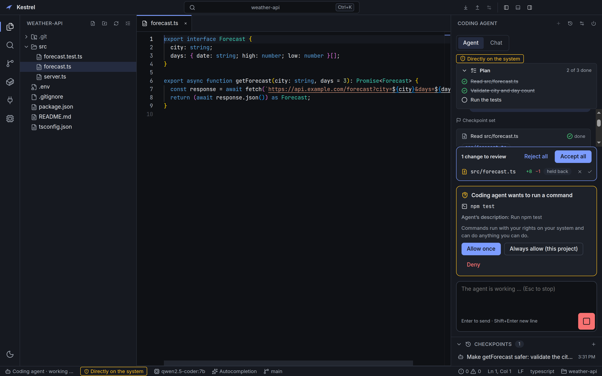
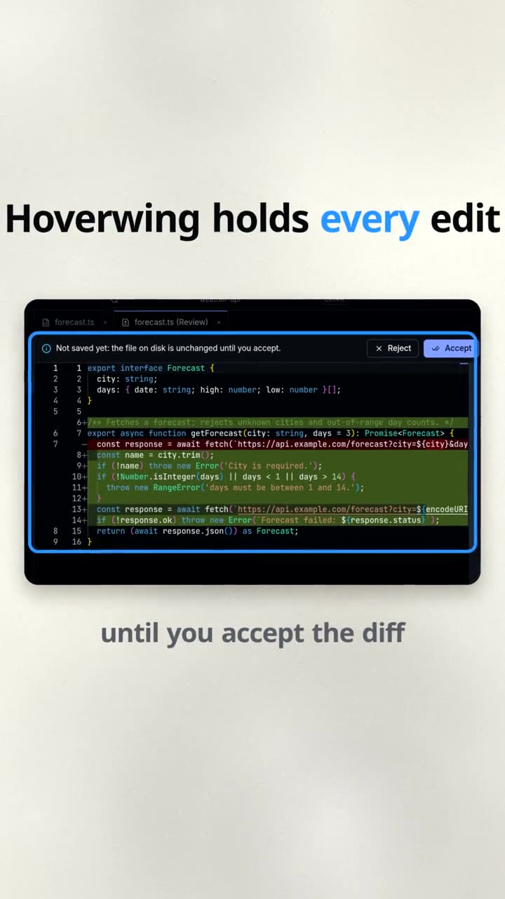
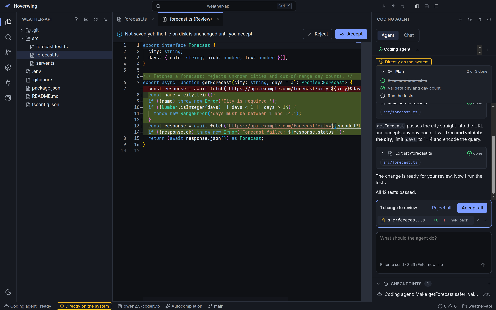
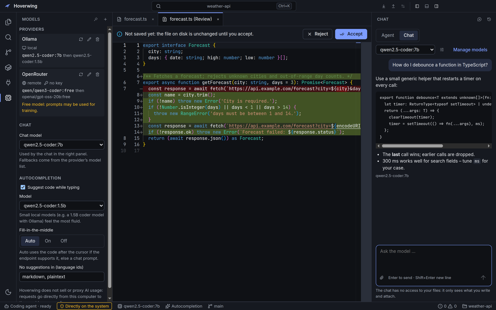
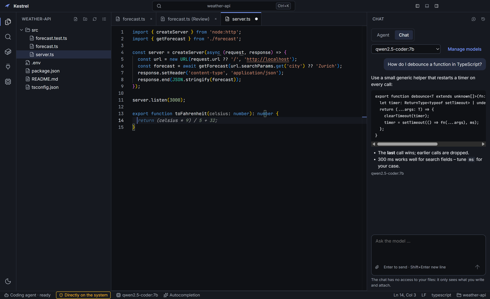
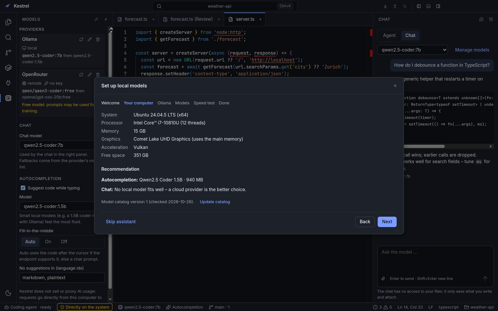
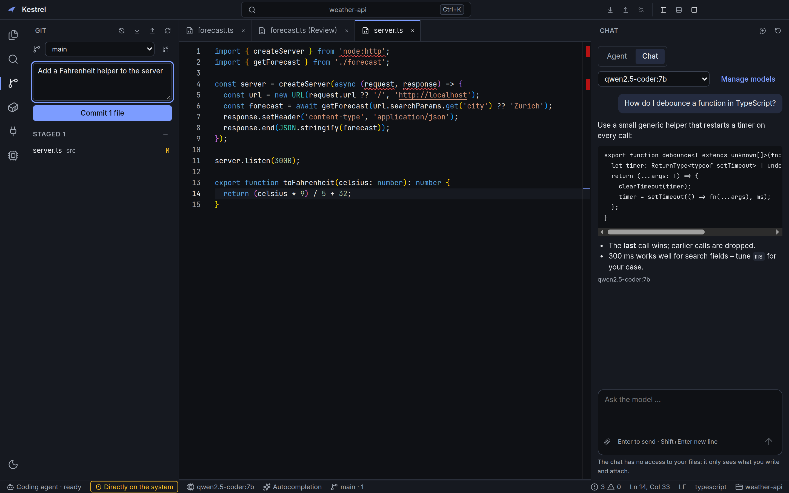
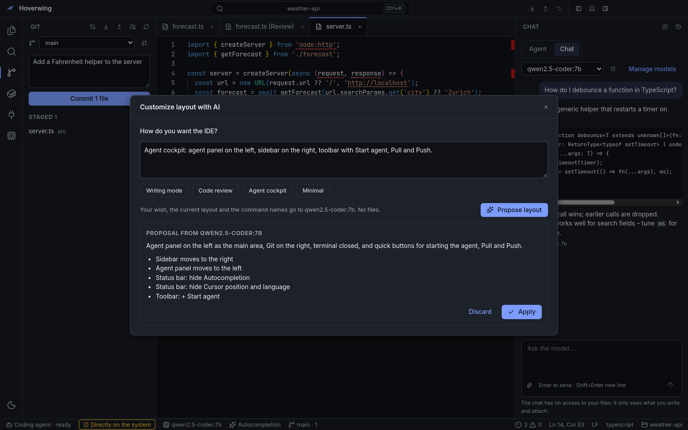
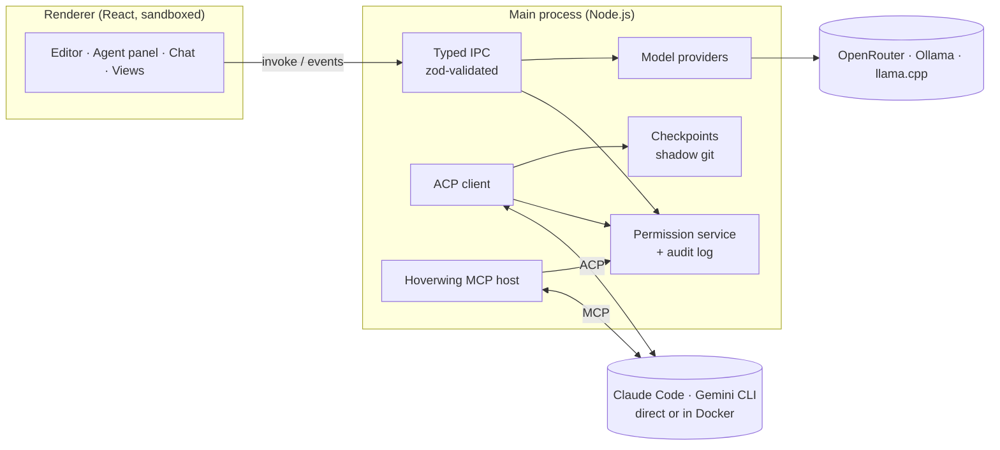

<div align="center">



# Hoverwing

**A desktop IDE for coding agents that holds every edit for your review.**

Run Claude Code, Gemini CLI, your own API key or a local model in your project.
Hoverwing shows what the agent plans, asks before it runs anything risky, keeps its
file changes until you accept them and saves a checkpoint before every turn.

[](https://github.com/IlianBurri/hoverwing/actions/workflows/ci.yml)
[](https://github.com/IlianBurri/hoverwing/releases)

[](LICENSE)

[**Website**](https://ilianburri.github.io/hoverwing/) · [**Download**](#download) · [Quick start](#quick-start) · [Features](#features) ·
[Limitations](#limitations) · [Security](#security-by-default) · [Development](#development) · [Contributing](#contributing)

**Early (version 0.9) and looking for testers:** try it on a real project and
[tell us what was unclear](https://github.com/IlianBurri/hoverwing/issues/new?template=feedback.yml).

<br />



<br />

<a href="https://ilianburri.github.io/hoverwing/#video"></a>

▶ [**Hoverwing in 34 seconds**](https://ilianburri.github.io/hoverwing/#video) · <sub>made with AI (Claude Code and a video skill); the screens are the real app</sub>

<sub>Formerly called Kestrel (renamed in October 2026). Not related to other projects named Kestrel.</sub>

</div>

## Why Hoverwing?

Coding agents are powerful, and they work on your files, run commands and read your
secrets if you let them. Hoverwing is not another AI: it is the **cockpit around the
AI you already use**.

- 🛡️ **Nothing risky happens silently.** Writes, commands, browser and MCP access
  ask first. Secret files (`.env`, keys, `.ssh`) are always blocked.
- 🔍 **Every change is reviewable.** Accept or reject agent edits per file or per
  hunk, and jump back to any checkpoint before an agent turn.
- 📦 **Optional Docker sandbox.** Run an agent in a hardened container that only sees
  your project.
- 🔌 **Bring your own AI.** Agents via the Agent Client Protocol, any OpenAI-compatible
  endpoint (OpenRouter …) or local models with Ollama and llama.cpp. No account, no
  middleman, no telemetry.

## Quick start

1. **Install** the file for your system from [Download](#download).
2. **Open a folder** (_Open folder …_ on the welcome page, or `Ctrl+O` / `Cmd+O`).
3. **Pick an agent** in the agent panel on the right (Claude Code and Gemini CLI are
   included), click **Start** and confirm the command line once. Sign in inside the
   agent the way you normally do (for Claude Code: run `claude` and `/login` in a
   terminal); Hoverwing never sees those credentials.
4. **Ask for a change**, e.g. “add input validation to the signup form”.

What you get: the agent's plan and tool calls in the panel, a question before every
command it wants to run, and its edits under **Changes**, where you accept or reject
them. Nothing is written to disk before you accept (with _Review changes_ on, the
default for new agents). **Checkpoints** at the bottom of the panel undo a whole turn.

No agent? Add an OpenRouter key or a local model under **Models** and use the
built-in chat; the setup assistant (command palette → _Setup assistant_) checks your
hardware and installs Ollama.

## Features

<table>
  <tr>
    <td width="50%" valign="top">
      <h3>🤖 Agents with guard rails</h3>
      Start Claude Code, Gemini CLI or any ACP agent in your project. See its plan,
      tool calls and answers live; approve commands once or always for the project;
      stop it at any time. Pick model, effort and mode per tab where the agent offers
      them, and see how full its context is. Run up to four agents side by side in
      tabs – a file one agent is changing stays locked for the others until you decide.
    </td>
    <td width="50%" valign="top">
      <h3>🧾 Diff review &amp; checkpoints</h3>
      Agent writes are held until you accept them – per file or per section. Before
      every turn, Hoverwing saves a checkpoint in a separate git repository (your own
      <code>.git</code> stays untouched).
    </td>
  </tr>
  <tr>
    <td colspan="2"></td>
  </tr>
  <tr>
    <td width="50%" valign="top">
      <h3>💬 Built-in chat</h3>
      Ask a model of your choice – streamed answers, Markdown and code, earlier chats.
      The chat has no file access: attach the current file or selection explicitly.
      Rate-limited free models fall back to the next one automatically.
    </td>
    <td width="50%" valign="top">
      <h3>✨ Inline autocompletion</h3>
      Ghost-text suggestions from your own model – ideally a small local one.
      Fill-in-the-middle when the endpoint supports it, debounced and cancelled while
      you type, switchable per language. Secret files are never sent.
    </td>
  </tr>
  <tr>
    <td></td>
    <td></td>
  </tr>
  <tr>
    <td width="50%" valign="top">
      <h3>🧭 Setup assistant</h3>
      Detects your GPU, memory and acceleration (CUDA, ROCm, Metal, Vulkan, CPU),
      recommends models from an updatable catalog, installs Ollama from the official
      release with a verified SHA-256 checksum, downloads the models and measures their
      speed.
    </td>
    <td width="50%" valign="top">
      <h3>🧠 Language servers &amp; Git</h3>
      Completion, hover, go to definition and a Problems list from real language
      servers (TypeScript, Pyright, rust-analyzer, gopls or your own). A Git panel to
      stage, commit, switch branches, diff, pull and push. Sign in with GitHub to clone
      your repositories and push over HTTPS – the token stays in your keychain. Agents
      can read the current problems through Hoverwing's <code>get_diagnostics</code> tool.
    </td>
  </tr>
  <tr>
    <td width="50%" valign="top" colspan="2">
      <h3>🧰 Everything around it</h3>
      Your layout: any command as a toolbar button, panels on either side, saved
      layouts – or describe the IDE you want and let your chat model propose it
      (preview first, undo anytime).<br />
      Monaco editor, ripgrep project search, terminals, a Docker panel, an integrated
      browser the agent can inspect (content marked as untrusted), an MCP manager with
      per-tool permissions, command palette, German and English, dark and light themes.
    </td>
  </tr>
  <tr>
    <td colspan="2"></td>
  </tr>
  <tr>
    <td></td>
    <td></td>
  </tr>
</table>

## Bring your own AI

| You have …                         | Use it in Hoverwing as                                                                                    |
| ---------------------------------- | --------------------------------------------------------------------------------------------------------- |
| Claude Code, Gemini CLI, other ACP | **Agent** – templates included; log in inside the agent itself (Hoverwing never touches your credentials) |
| An OpenRouter / OpenAI-style key   | **Provider** for chat and autocompletion – keys live only in the system keychain                          |
| A local model                      | **Ollama** or **llama.cpp** – the setup assistant installs and configures Ollama for you                  |
| MCP servers                        | **MCP manager** – Hoverwing proxies their tools to agents, with a permission level per tool               |

## Download

Get the newest version from **[Releases](https://github.com/IlianBurri/hoverwing/releases)**:

| System                | File                                  | First start                                                                         |
| --------------------- | ------------------------------------- | ----------------------------------------------------------------------------------- |
| Windows 10/11 (x64)   | `Hoverwing-Setup-<version>.exe`       | SmartScreen may warn (not code-signed yet): _More info → Run anyway_                |
| macOS (Apple Silicon) | `Hoverwing-<version>-arm64.dmg`       | Not notarized: open once, then _System Settings → Privacy & Security → Open Anyway_ |
| Linux (x64)           | `Hoverwing-<version>-x86_64.AppImage` | `chmod +x Hoverwing-*.AppImage`, then start it                                      |

Releases up to 0.9.1 still carry the old name (`Kestrel-…`). Picking model, effort and
mode per agent, and the GitHub sign-in, arrive with the next release.

The Windows installer lets you choose the folder and creates desktop and start-menu
shortcuts. Installed apps on Windows and Linux check for new versions on start and
offer the update in the status bar (macOS needs a signed build for that) – nothing
is downloaded without your click (switch it off with
_Turn off automatic update check_ in the command palette). Settings, keys and
checkpoints survive updates and uninstalling. What the app connects to, and when,
is listed in [PRIVACY.md](PRIVACY.md).

**Uninstall:** Windows – _Settings → Apps → Installed apps → Hoverwing → Uninstall_;
macOS – move Hoverwing from _Applications_ to the trash; Linux – delete the AppImage.
Settings, keys and checkpoints stay in the app data folder (`%APPDATA%\Hoverwing`,
`~/Library/Application Support/Hoverwing`, `~/.config/Hoverwing`); delete it to remove
them too. Coming from Kestrel: the first start copies the old `Kestrel` folder there;
on macOS and Linux, saved API keys and sign-ins have to be entered once more.

## Limitations

Hoverwing is young. Know these before you rely on it:

- **Unsigned builds.** Windows shows “unknown publisher”, macOS needs _Open Anyway_.
  Updates in the app work on Windows and Linux; macOS needs a signed build, so update
  by downloading the new `.dmg` there.
- **Platforms:** Windows x64, macOS on Apple Silicon (no Intel build), Linux x64 as an
  AppImage (glibc 2.35 or newer, e.g. Ubuntu 22.04+).
- **Agents run on your system by default.** Hoverwing guards what goes through it
  (file writes, commands it is asked about, its browser and MCP tools), but an agent
  like Claude Code can also read project files itself. For full isolation turn on the
  Docker sandbox for that agent.
- **Parallel agents share one folder.** Up to four agents work in the same project;
  a file one agent changes is locked for the others, but there are no isolated
  copies (worktrees) yet.
- **GitHub sign-in** needs Hoverwing's OAuth app, which is not registered yet: until
  then the GitHub dialog says it is not set up. Git over SSH or your own credential
  helper works as usual.
- **Not an AI provider.** Hoverwing brings no model or agent of its own; you connect
  yours. Settings, chats and checkpoints stay on your computer.

### Code signing policy

The Windows installers are not code-signed yet, so SmartScreen shows "unknown
publisher" on the first start (_More info → Run anyway_). The rules below apply
as soon as releases are signed.

- Only binaries built by GitHub Actions from this repository
  ([Release workflow](.github/workflows/release.yml)) will be signed. Upstream
  binaries (Electron's libraries, ripgrep, node-pty) are included as published by
  their projects.
- Every release signing request will be approved by hand.
- **Committers and reviewers:** [IlianBurri](https://github.com/IlianBurri)
  (changes from other contributors are reviewed before they are merged)
- **Approvers:** [IlianBurri](https://github.com/IlianBurri)
- **Privacy:** this program will not transfer any information to other networked
  systems unless specifically requested by the user or the person installing or
  operating it. Exceptions, both can be turned off: the update check on start
  (GitHub) and the first download of the TypeScript language server (npm) in a
  trusted project. Signing in to GitHub contacts `github.com` and `api.github.com`
  only when you ask for it. The Windows installer shows this notice before installing.
  Details in [PRIVACY.md](PRIVACY.md).

## Security by default

- **Hardened Electron:** sandboxed renderer without Node.js, context isolation, a
  strict Content-Security-Policy, blocked navigation and new windows.
- **Narrow, typed IPC:** one channel per action, every request validated with zod in
  the main process. Paths are always relative to the project and checked against
  escapes (including symlinks).
- **Central permission system** with allow / ask / deny rules per project and an
  audit log. Rules live in the app data folder, where agents cannot edit them.
- **Secrets stay secret:** API keys only in the OS keychain (`safeStorage`); a key is
  dropped when its provider's address changes. Secret files are never shown to agents
  or sent to models. Content from the web and MCP servers reaches agents marked as
  untrusted data.
- **Verified downloads:** installers only from official GitHub releases, checked
  against the published SHA-256 before anything runs; app updates are verified by
  electron-updater (SHA-512).
- **Restricted mode for unknown projects:** language servers and Git actions can run
  code from a project (tsserver plugins, hooks, filters). They only run after you
  trust the project in a native dialog; until then Git only reads, with the
  repository's filters and fsmonitor disabled.
- **No telemetry.** Hoverwing does not sell or proxy AI usage.

## Architecture



Hoverwing is a pnpm monorepo: `apps/desktop` (Electron + React + TypeScript, built with
electron-vite) and `packages/shared` (the IPC contract and schemas shared by all
processes). See [`CLAUDE.md`](CLAUDE.md) for the architecture rules and
[`SPEC.md`](SPEC.md) for the product specification.

```
apps/desktop/
  src/main/modules/   agent, browser, chat, checkpoints, completion, docker, mcp,
                      mcpHost, permissions, providers, review, sandbox, search,
                      setup, settings, terminal, updates, workspace
  src/preload/        the typed bridge (window.kestrel)
  src/renderer/       layout, features, components, stores, design tokens, i18n
  e2e/                Playwright tests against the built app
packages/shared/      IPC contract (zod schemas per module) and domain schemas
```

## Development

**Requirements:** Node.js ≥ 22.12, pnpm 10 (`corepack enable`), Git. Optional: Docker
for the agent sandbox. On Linux, `node-pty` is compiled during install (needs
`build-essential` and `python3`).

```bash
pnpm install
pnpm dev
```

| Command                                        | What it does                                     |
| ---------------------------------------------- | ------------------------------------------------ |
| `pnpm dev`                                     | Start the app with hot reload                    |
| `pnpm lint` / `pnpm typecheck`                 | ESLint (type-aware) / TypeScript in all packages |
| `pnpm test`                                    | Unit tests (Vitest)                              |
| `pnpm test:e2e`                                | Build, then E2E tests with Playwright + Electron |
| `pnpm --filter @kestrel/desktop package:win`   | Windows installer in `apps/desktop/release/`     |
| `pnpm --filter @kestrel/desktop package:mac`   | macOS disk image (on a Mac)                      |
| `pnpm --filter @kestrel/desktop package:linux` | Linux AppImage                                   |

<details>
<summary>More: Docker tests, screenshots, releases</summary>

- Headless Linux: `xvfb-run -a pnpm test:e2e`.
- Tests against a real Docker daemon: `KESTREL_DOCKER_TESTS=1 pnpm test` and
  `KESTREL_E2E_DOCKER=1 xvfb-run -a pnpm test:e2e` (optional
  `KESTREL_SANDBOX_BASE_IMAGE=<mirror>`, `KESTREL_SANDBOX_PACKAGES=""`).
- README screenshots are rendered from the real app with a demo project:
  `cd apps/desktop && pnpm build && KESTREL_SCREENSHOTS=1 npx playwright test e2e/screenshots.spec.ts`.
- **Release:** bump `version` in `apps/desktop/package.json`, commit, then
  `git tag v<version> && git push origin v<version>`. The _Release_ workflow builds
  Windows, macOS and Linux installers, smoke-tests the Windows build and publishes
  them with the update feed. Code signing: see
  [docs/code-signing.md](docs/code-signing.md).

</details>

<details>
<summary>Keyboard shortcuts</summary>

`Mod` is `Cmd` on macOS and `Ctrl` elsewhere.

| Shortcut                         | Action                        |
| -------------------------------- | ----------------------------- |
| `Mod+K`, `Mod+Shift+P`           | Command palette               |
| `Mod+O`                          | Open folder                   |
| `Mod+B` / `Mod+J`                | Toggle sidebar / bottom panel |
| `Mod+Alt+B`                      | Toggle agent panel            |
| `Mod+L`                          | Focus the agent input         |
| `Mod+Shift+E` / `Mod+Shift+F`    | Files / project search        |
| `Mod+S`, `Mod+Alt+S`             | Save, save all                |
| `Mod+W`, `Ctrl+Tab`              | Close tab, next tab           |
| `` Ctrl+` `` / ``Ctrl+Shift+` `` | Show terminal / new terminal  |
| `Mod+Shift+G` / `Mod+Shift+M`    | Git / Problems                |
| `Mod+Shift+D`                    | Docker panel                  |
| `Mod+Shift+O`                    | New browser tab               |
| `Mod+Shift+Escape`               | Stop the agent's turn         |

Inside a terminal on Windows/Linux, `Ctrl+<letter>` goes to the shell; use
`Ctrl+Shift+P` for the palette there. Shortcuts can be changed in `settings.json` in
the app data folder: `"keybindings": { "view.toggleSidebar": "Mod+Shift+B" }`.

</details>

## Contributing

Hoverwing is built in the open, and help of any size is welcome:

- **Try it** on a real project and share your
  [first impressions](https://github.com/IlianBurri/hoverwing/issues/new?template=feedback.yml).
- **Report bugs** or wish for features with the
  [issue templates](https://github.com/IlianBurri/hoverwing/issues/new/choose).
- **Fix something small:** look for
  [`good first issue`](https://github.com/IlianBurri/hoverwing/labels/good%20first%20issue)
  and read [CONTRIBUTING.md](CONTRIBUTING.md).

## Roadmap

| Phase | Content                                                                   | Status                 |
| ----- | ------------------------------------------------------------------------- | ---------------------- |
| 0–1   | Foundation, workbench, command palette, workspace, Monaco, terminal       | ✅                     |
| 2     | Permission system, agents via ACP, diff review, checkpoints               | ✅                     |
| 3–4   | Agent sandbox in Docker, Docker panel                                     | ✅                     |
| 5–6   | Integrated browser with agent tools, MCP manager                          | ✅                     |
| 7     | Model providers, built-in chat, inline autocompletion                     | ✅                     |
| 8     | Setup assistant, installers and auto-update                               | ✅                     |
| 9     | Language servers (go to definition, diagnostics) and a Git panel          | ✅                     |
| 10    | Parallel agents in tabs; model, effort and mode per agent                 | ✅                     |
| 11    | GitHub sign-in: clone your repositories, push and pull over HTTPS         | 🚧 needs the OAuth app |
| Next  | Isolated copies for parallel agents, signed installers, more UI languages | 💡                     |

## Trademarks

Hoverwing is an independent project. It supports Claude Code via the Agent Client
Protocol but is not affiliated with or endorsed by Anthropic. All product names
belong to their owners.

## License

[MIT](LICENSE) © 2026 Hoverwing contributors
